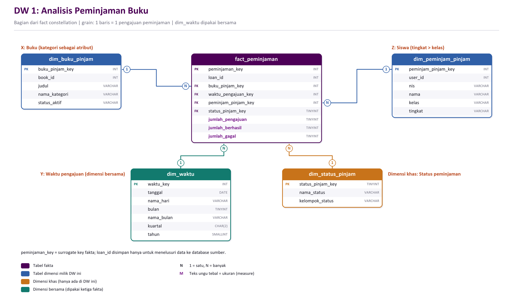
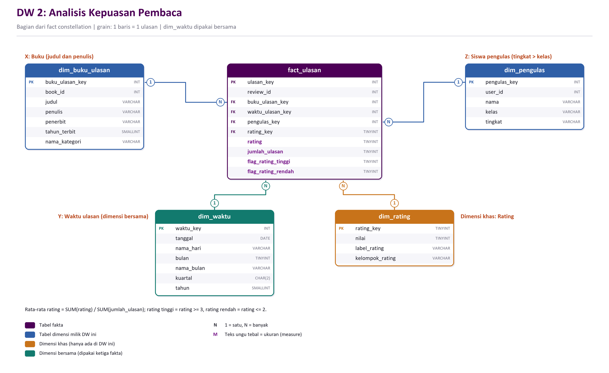
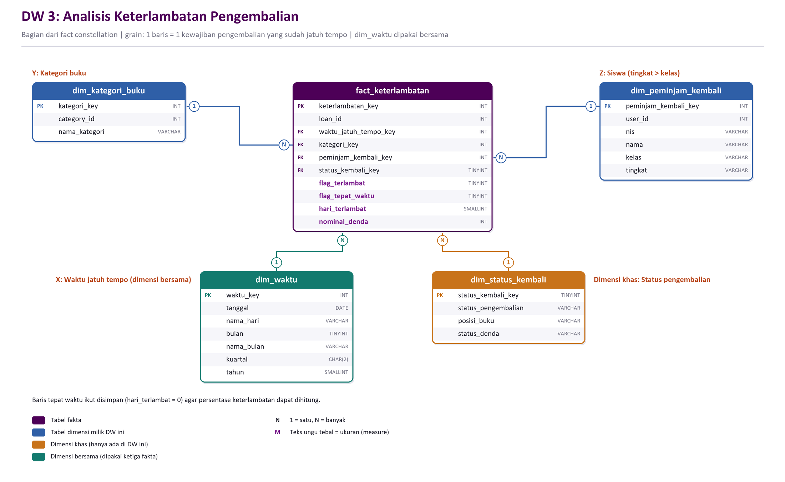
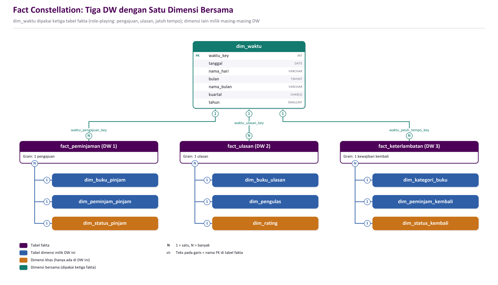

# Data Warehouse Smart Reading Room (Revisi)

> **Arsip.** Dokumen ini menjelaskan rancangan sebelum fact constellation dan sebelum peminjam dibatasi siswa. Rancangan dan struktur folder yang berlaku ada di `../README.md` dan `Panduan-Pengerjaan-Implementasi-DW.pdf`.

Kelompok G, Basis Data, Universitas Airlangga

Dokumen ini merangkum rancangan tiga data warehouse (DW) untuk Smart Reading Room setelah revisi. Laporan lengkapnya ada di `Laporan-Data-Warehouse-Smart-Reading-Room-Revisi.docx` (beserta versi PDF).

## Isi folder

| File | Isi |
|---|---|
| `01_ddl_data_warehouse.sql` | Membuat database `basdat_dw` dan 15 tabel (3 fakta, masing-masing dengan 4 dimensi sendiri) |
| `02_dummy_data_sumber.sql` | Data dummy pada database sumber (opsional) |
| `02b_hapus_dummy_data.sql` | Menghapus data dummy |
| `03_etl_data_warehouse.sql` | ETL dari `basdat_github` ke `basdat_dw`, plus rekonsiliasi |
| `04_query_analisis.sql` | Query information package dan strategic information |
| `buat_gambar_skema.py` | Membuat gambar skema ke `gambar/` (`MODE=bersih` untuk `gambar-tanpa-judul/`) |
| `buat_laporan.js` | Membuat laporan Word dari `hasil-query.json` (hasil `04_query_analisis.sql`) |

## Ringkasan revisi

| | Sebelum | Sesudah |
|---|---|---|
| DW 2 | Analisis Peminjam (1 peminjam per bulan) | **Analisis Kepuasan Pembaca** (1 ulasan) |
| Dimensi | Waktu, Bulan, Buku, Kategori, Penulis, Peminjam, Admin, 2 status (sebagian dipakai bersama) | **4 dimensi milik tiap DW**, tidak ada yang dipakai bersama; tiap DW punya 1 dimensi khas |
| PK fakta | `loan_id` / `review_id` | **Surrogate key AUTO_INCREMENT** (`peminjaman_key`, `ulasan_key`, `keterlambatan_key`); `loan_id`/`review_id` jadi kolom unik untuk penelusuran |
| Skema DW 1 | Snowflake + bridge penulis | **Star** (kategori menjadi atribut `dim_buku_pinjam`) |
| Kelompok peminjam | Siswa / Tenaga Pendidik | **Kelas 10, Kelas 11, Kelas 12, Tenaga Pendidik** (`kelompok_peminjam`) |
| DW 3 | Keterlambatan dan denda (status pelunasan, admin) | **Keterlambatan** dengan fokus bulan jatuh tempo |

## Tiga data warehouse

| | DW 1 Peminjaman Buku | DW 2 Kepuasan Pembaca | DW 3 Keterlambatan |
|---|---|---|---|
| Fokus | Volume peminjaman | Kepuasan pembaca | Kepatuhan pengembalian |
| Sumber | `loans` | `reviews` | `loans` (denda dihitung) |
| Grain | 1 pengajuan peminjaman | 1 ulasan | 1 kewajiban pengembalian yang sudah jatuh tempo |
| X | `dim_buku_pinjam` | `dim_buku_ulasan` | `dim_waktu_jatuh_tempo` |
| Y | `dim_waktu_pengajuan` | `dim_waktu_ulasan` | `dim_kategori_buku` |
| Z | `dim_peminjam_pinjam` | `dim_pengulas` | `dim_peminjam_kembali` |
| Dimensi khas | `dim_status_pinjam` | `dim_rating` | `dim_status_kembali` |
| Ukuran | jumlah_pengajuan, jumlah_berhasil, jumlah_gagal | rating, jumlah_ulasan, flag_rating_tinggi (≥3), flag_rating_rendah (≤2) | flag_terlambat, flag_tepat_waktu, hari_terlambat, nominal_denda |
| Tabel fakta | `fact_peminjaman` | `fact_ulasan` | `fact_keterlambatan` |
| Skema | Star | Star | Star |

Setiap DW adalah star schema yang berdiri sendiri: tidak ada tabel dimensi yang dipakai dua fakta, sehingga setiap fakta menghasilkan informasi yang berbeda dan perubahan pada satu DW tidak memengaruhi DW lain. Aturan kalender dan kelompok peminjam ditulis sekali di ETL (tabel sementara) lalu dimuat ke dimensi masing-masing DW, jadi isinya tetap konsisten. Bila hasil DW 1 dan DW 2 perlu dibandingkan per buku, keduanya diringkas dulu lalu dicocokkan lewat `book_id` (lihat query perbandingan di `04_query_analisis.sql`).

`kelompok_peminjam` diturunkan dari kolom `class` saat ETL (`XII...`/`12...` menjadi Kelas 12, dan seterusnya). Akun yang kelasnya tidak dikenali masuk ke `Lainnya`; pada data asli ini dua akun uji (kelas `s` dan `QA`). ETL menampilkan daftarnya agar bisa dirapikan di data sumber.

## Cara menjalankan

1. Backup `basdat_github` (file `basdat_final.sql` sudah ada).
2. Di phpMyAdmin tab SQL (atau terminal `mysql`), jalankan berurutan: `01_ddl`, `02_dummy_data_sumber` (opsional), `03_etl`, `04_query_analisis`. DDL ikut menghapus tabel versi lama di `basdat_dw`.
3. Jika data sumber berubah, cukup jalankan ulang `03_etl_data_warehouse.sql`.
4. Setelah selesai, `02b_hapus_dummy_data.sql` mengembalikan database aplikasi seperti semula.

Membuat ulang laporan: simpan hasil `04_query_analisis.sql` ke `hasil-query.json` (format: satu array baris per query, urutan sama dengan file), lalu `node buat_laporan.js hasil-query.json` (butuh paket npm `docx`).

Persyaratan: MySQL 8.0 (CTE rekursif, window function, `ROLLUP`, `REGEXP`).

## Keterbatasan

- Data asli kecil (26 peminjaman, 8 ulasan), sehingga analisis tren memakai data dummy.
- Keterlambatan dan denda untuk buku yang belum kembali dihitung sampai tanggal ETL, jadi angkanya berubah setiap kali ETL dijalankan.
- Dimensi SCD Tipe 1: perpindahan kelas siswa tidak tercatat riwayatnya.
- ETL full refresh cocok untuk data kecil; data besar membutuhkan incremental load.

## Kemungkinan pertanyaan dosen

**Mengapa setiap DW punya dimensi sendiri?** Agar setiap fakta jelas menghasilkan output yang berbeda dan DW tidak saling bergantung. Masing-masing juga punya satu dimensi khas (status peminjaman, rating, status pengembalian).

**Mengapa PK fakta berupa surrogate key, bukan `loan_id`?** Agar setiap tabel fakta punya identitas sendiri dan tidak terlihat sebagai duplikat tabel lain. `loan_id` dan `review_id` tetap disimpan dengan indeks unik untuk menelusuri data ke sumber.

**Mengapa DW 2 tidak tumpang tindih dengan DW 1?** DW 1 mengukur seberapa sering buku dipinjam, DW 2 mengukur seberapa puas pembacanya. Hasilnya bisa berbeda: buku yang paling sering dipinjam belum tentu memiliki rating tertinggi.

**Mengapa rata-rata rating tidak disimpan?** Rata-rata tidak bisa dijumlahkan antar baris. Yang disimpan adalah rating dan jumlah ulasan, lalu rata-rata dihitung saat query.

**Mengapa baris tepat waktu ikut disimpan di DW 3?** Agar persentase keterlambatan bisa dihitung (terlambat dibagi seluruh kewajiban), bukan hanya jumlah kasus terlambat.

**Mengapa kategori tidak dibuat tabel sendiri?** Kategori disimpan sebagai atribut `dim_buku_pinjam` dan `dim_buku_ulasan` supaya skema tetap star dan query cukup satu join per dimensi.
